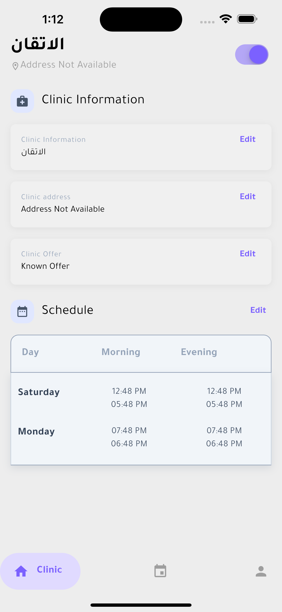
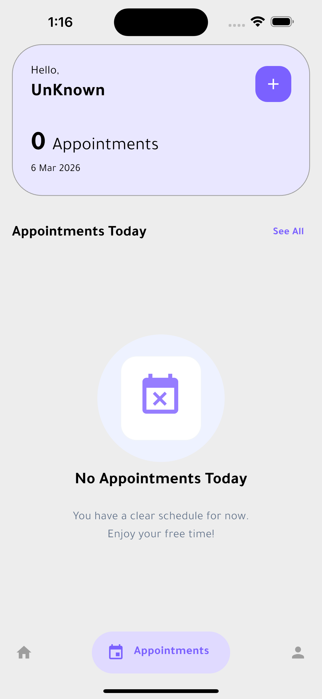
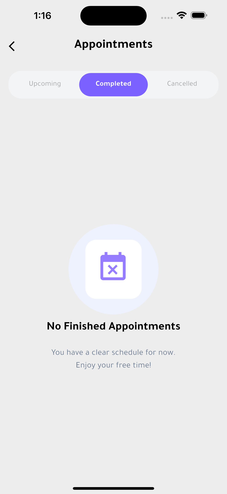
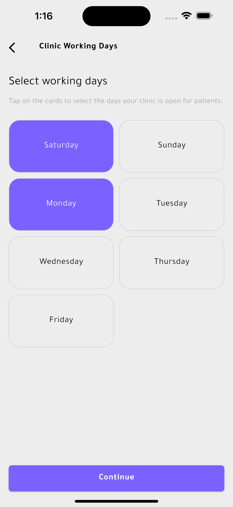
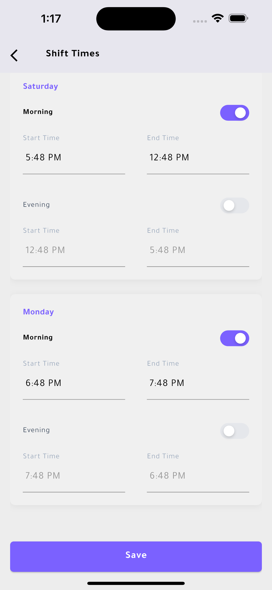

# Tabibak for Clinic

The clinic-side companion app for [Tabibak](https://github.com/abdelrahman3003/Tabibak). Clinics use it to manage their practice on the Tabibak platform: doctors, schedules, and appointment requests coming from patients.
[](https://play.google.com/store/apps/details?id=app.temsah.tabibak_for_clinic)

## 📸 Screenshots

<p float="left">
  
  
  
  
  
</p>

## ✨ Features

- Clinic onboarding and profile management
- Manage doctors and their working schedules
- View and handle patient appointment requests
- Secure sign-in with Google and phone OTP verification
- Arabic / English UI with full RTL support

## 🛠️ Tech stack

- **Flutter & Dart**
- **State management:** Bloc / Cubit (`flutter_bloc`)
- **Architecture:** Clean Architecture with `dartz` and `equatable` (feature-first: `core` + `feature`)
- **Backend:** Supabase + REST APIs (`dio`)
- **Dependency injection:** `get_it`
- **Storage:** `flutter_secure_storage`, `shared_preferences`, `cached_network_image`
- **Also:** `easy_localization`, `pinput` (OTP), `google_sign_in`, `skeletonizer`

## 📁 Project structure

```
lib/
├── core/          # DI, services, networking, shared widgets
├── feature/       # app features (data / domain / presentation)
├── layout_screen.dart
└── main.dart
```

## 🚀 Getting started

```bash
flutter pub get
flutter run
```
